<div align="center">
  

  # 🐾 ARCA DE NOÉ

  ### Cuidando daqueles que não têm voz

  **Uma plataforma digital para resgatar histórias, conectar corações e transformar vidas.**

  <a href="https://arca-de-noe-phi.vercel.app" target="_blank"><strong>🌐 Visitar o projeto</strong></a>
</div>

<br>

<div align="center">
  
  
  
  
</div>

## 🌊 Sobre o projeto

A **Arca de Noé** é uma plataforma criada para dar visibilidade ao trabalho da Associação Arca de Noé, em Várzea da Palma, e facilitar o encontro entre animais resgatados e novas famílias.

Mais do que uma página institucional, este projeto é uma ponte entre quem precisa de ajuda e quem deseja ajudar. Cada formulário enviado, cada adoção iniciada e cada doação realizada pode se transformar em uma nova chance.

> **Uma vida resgatada começa com um gesto.**

## ✨ O que você encontra aqui

- 🐶 **Histórias de resgate** — conheça a trajetória da associação e dos animais acolhidos.
- 🏡 **Adoção responsável** — formulário para pessoas interessadas em oferecer um novo lar.
- 💛 **Apadrinhamento** — apoie um animal mesmo quando a adoção ainda não é possível.
- ⭐ **Estrelinhas** — espaço para homenagens e apoio à causa.
- 💰 **Doações via Pix** — QR Code e cópia rápida da chave diretamente no site.
- 📸 **Dia a dia da ONG** — acompanhe atualizações, cuidados e momentos especiais.
- 🔐 **Painel administrativo** — gerenciamento de animais, solicitações, doações, documentos e publicações.
- 📱 **Experiência responsiva** — navegação adaptada para celular, tablet e desktop.

## 🧭 Como a experiência funciona

```text
Visitante
   │
   ├── Conhece a história da Arca
   ├── Encontra um animal ou uma forma de ajudar
   ├── Envia uma solicitação
   └── Acompanha o impacto da causa

Administrador
   │
   ├── Atualiza animais e publicações
   ├── Analisa pedidos de adoção e apadrinhamento
   ├── Registra doações
   └── Organiza documentos e informações da ONG
```

## 🛠️ Tecnologias

- **HTML5** para a estrutura semântica das páginas;
- **CSS3** para o layout, identidade visual e responsividade;
- **JavaScript** para carrosséis, formulários, autenticação da área administrativa e interações;
- **Font Awesome** para os ícones da interface;
- **Google Fonts** para a tipografia;
- **Vercel** como ambiente de publicação do site.

## 📁 Organização do projeto

```text
ARCA-DE-NOE/
├── assets/
│   └── imgs/              # Logos, QR Code e fotos dos animais
├── scripts/
│   ├── script.js          # Interações da página pública
│   └── admin-script.js    # Recursos do painel administrativo
├── styles/
│   └── style.css          # Estilos da aplicação
├── admin.html             # Painel administrativo
├── index.html             # Página principal
├── robots.txt             # Orientações para mecanismos de busca
└── sitemap.xml            # Mapa do site
```

## 🚀 Executando localmente

Como o projeto utiliza arquivos estáticos, basta cloná-lo e abrir a página no navegador:

```bash
git clone https://github.com/IRuanzzI/ARCA-DE-NOE.git
cd ARCA-DE-NOE
```

Depois, abra o arquivo `index.html` ou inicie um servidor local simples:

```bash
python3 -m http.server 8000
```

Acesse [http://localhost:8000](http://localhost:8000) no navegador.

> Para testar os recursos que dependem do painel e da API, configure também o serviço responsável pelo backend conforme o ambiente de desenvolvimento da ONG.

## 🤝 Como contribuir

Toda contribuição que melhora a comunicação da causa ou a experiência de quem quer ajudar é bem-vinda:

1. Faça um fork do projeto;
2. Crie uma branch para sua melhoria: `git checkout -b minha-melhoria`;
3. Faça as alterações e valide a experiência no navegador;
4. Envie um Pull Request descrevendo o impacto da mudança.

Antes de propor uma alteração visual, preserve os princípios do projeto: **acessibilidade, clareza, acolhimento e respeito aos animais**.

## 💚 Faça parte da mudança

Você pode ajudar de várias formas: adotando, apadrinhando, doando, divulgando ou simplesmente compartilhando uma história.

<div align="center">
  <br>
  <strong>🐾 Toda vida importa. Toda ajuda conta. 🐾</strong>
  <br><br>
  <a href="https://arca-de-noe-phi.vercel.app">Conheça a Arca de Noé</a>
</div>
